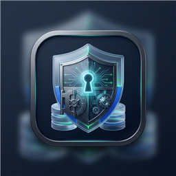

<p align="center">
  
</p>

# SQLitePass 🛡️

A modern, lightweight, and ultra-resilient password manager for Windows (.NET 8 C# + WPF) inspired by the core capabilities of **KeePass 2**, but re-engineered from the ground up to **permanently eliminate database corruption and catastrophic data loss**.

---

## 💡 Why SQLitePass instead of KeePass?

In traditional KeePass `.kdbx` files, the entire database is stored as a single monolithic encrypted binary blob. If a Windows update, system crash, bluescreen, or power outage interrupts a write operation, even a single altered byte in the header will render **100% of your credentials completely unrecoverable** (*"Header corrupt"* or *"HMAC mismatch"* errors).

### The SQLitePass Architectural Solution:

1. **Unencrypted Database at the File Level (Field-Level Encryption):**
   * The `.kpd` file is a standard SQLite database that can be inspected, queried, and repaired at any time using standard tools (such as *DB Browser for SQLite*).
   * **Zero-Knowledge Field-Level Encryption:** Sensitive fields (Passwords, Notes, Attachments, Custom Fields) are encrypted individually using **AES-256-GCM** with keys derived via **Argon2id** (memory-hard, GPU/ASIC resistant).
   * *The benefit:* Even in the worst-case scenario of physical bad sectors on disk, only the affected row or byte is impacted—**all other passwords and groups remain completely intact and decryptable**.

2. **WAL (Write-Ahead Logging) Mode:**
   * Native ACID transactions with `PRAGMA journal_mode = WAL;` and `PRAGMA synchronous = NORMAL;`. Changes are written sequentially to a dedicated WAL append-only log before commit. In the event of a sudden power outage, SQLite automatically replays or rolls back incomplete operations to the last consistent state.

3. **Isolated Atomic Dual-Backup (`.kpd.backup`):**
   * SQLitePass only keeps the primary database file open in memory.
   * On every change (add, update, delete), an atomic snapshot is created via SQLite's online backup API to a temporary file and swapped into `[vault].kpd.backup` using atomic OS file replacement.
   * The backup file is **never kept open**, completely eliminating concurrent file corruption risks.
   * Built-in **"Restore from .backup"** button directly in the initial unlock screen.

4. **Proactive Database Integrity Check (`PRAGMA quick_check;`):**
   * Automatically verifies physical SQLite page consistency on vault unlock. If file corruption is detected, SQLitePass immediately alerts the user and offers instant one-click recovery from the synchronized `.kpd.backup` file.

5. **Zero-Configuration Embedded Engine:**
   * Powered by embedded SQLite—no database servers, background services, daemon processes, or open ports required.

---

## 🛡️ Security & Privacy Hardening

* **Anti-Screenshot & Screen Capture Protection (Anti-Spyware):**
  * Integrated native Win32 `SetWindowDisplayAffinity(WDA_EXCLUDEFROMCAPTURE / WDA_MONITOR)`.
  * Application windows (Unlock Vault, Dashboard, Entry Editor, Settings) appear **completely blacked out or invisible** to screen capture software, video recording tools (OBS, Discord screen share, Teams, TeamViewer), and background screenshot malware. Can be toggled in *Settings*.

* **In-Memory Key File Sanitization:**
  * Key file byte buffers (`_keyFileBytes`) are immediately zeroed out in memory using `CryptographicOperations.ZeroMemory` within guaranteed `finally` blocks upon Argon2id key derivation, dialog closing, or option deselection.

* **RAM Purge on Vault Lock:**
  * When locking the vault, SQLitePass disposes encryption engines, clears credentials in memory, and triggers explicit garbage collection (`GC.Collect()` and finalizer synchronization) to purge sensitive string remnants from RAM.

---

## 🚀 Key Features & Productivity

* **Full Drag & Drop Organization:**
  * **Entries to Folders:** Drag and drop accounts directly from the DataGrid onto sidebar folders to organize them instantly.
  * **Folder Hierarchy & Nesting:** Drag and drop folders inside other folders to create nested subfolders.
  * **Folder Reordering:** Drag folders above or below other folders to reorder them at the same level.
  * **Folder Elevation:** Drag folders out to empty space to promote them back to root level.
  * **Anti-Loop Safety:** Built-in cycle detection blocks accidental loops (cannot drop a folder into itself or its own descendants).
  * **Keyboard & Context Controls:** Quickly reorder folders via right-click or shortcuts: **Move Up** (`Ctrl+Up`), **Move Down** (`Ctrl+Down`), and **Move to Parent Level**.

* **Recycle Bin with Soft-Delete:**
  * Deleting an entry moves it safely into the default **"Cestino" (Recycle Bin)** folder to prevent accidental data loss.
  * Permanent deletion requires confirmation only when deleting directly from within the Recycle Bin or using the **"Empty Recycle Bin..."** action.

* **Interactive DataGrid Column Sorting:**
  * Click any column header (*Title*, *User Name*, *Password*, *URL*, *Notes*, *Last Modified*) to sort entries in ascending or descending order.

* **Context-Aware Column Double-Clicking:**
  * **Password:** Instantly copies the password to the clipboard (without unmasking it) and triggers an automatic countdown to clear the clipboard (default 12s).
  * **User Name:** Copies the username to clipboard.
  * **URL:** Opens the URL directly in your default browser.
  * **Title / Row:** Opens the full entry editor dialog.

* **Smart Context-Aware Action Buttons:**
  * Toolbar buttons (Copy User, Copy Password, Open URL, Auto-Type) and context menu items dynamically enable only when the selected entry contains that specific data, eliminating misleading clicks on empty fields.

* **Global Auto-Type (`Ctrl+Alt+A`):**
  * System-wide hotkey using Windows `SendInput`: detects the focused window or browser tab title and automatically types credentials and customizable sequences (e.g. `{USERNAME}{TAB}{PASSWORD}{ENTER}`, `{DELAY 500}`).
  * Keystrokes are simulated directly without writing passwords to the Windows clipboard, bypassing clipboard sniffers.

* **Multi-Platform Vault Import & Export:**
  * **Bitwarden JSON Import (`.json`):** Full import of unencrypted Bitwarden vault exports, including usernames, passwords, URLs, notes, custom fields, and TOTP seeds.
  * **Web Browser CSV Import (`.csv`):** Auto-detects column structures and imports passwords exported from **Google Chrome, Microsoft Edge, Mozilla Firefox, Brave, and Opera**.
  * **KeePass 2 CSV Import & Export (`.csv`):** Seamless migration to and from KeePass 2.
  * **High-Performance Batch Engine:** Bulk imports run in a single atomic SQLite transaction with a single backup snapshot, importing thousands of items in under half a second.

* **Adaptive Dual Theme Design:**
  * **Refined Neutral Light Theme:** Soft, neutral Slate-50 (`#F8FAFC`) canvas with crisp white cards, delicate Slate-200/300 borders, soft dark text (`#0F172A`), and pastel selection pills for fatigue-free daylight use.
  * **Dark Obsidian / Zinc Theme:** Sleek deep Zinc-950 (`#09090B`) canvas with elevated Zinc-900 surfaces and Zinc-800 borders for low eye-strain in dim environments.
  * Quick theme toggle button (🌓) available both on the main toolbar and unlock window.

* **System Tray & Desktop Integration:**
  * Notification area (System Tray) icon with quick context menu.
  * *Minimize to Tray* option.
  * *Close button (X) minimizes to Tray instead of quitting* option.
  * *Start with Windows* integration.
  * *Always on top* mode.

* **Intelligent Auto-Lock:**
  * Inactivity timeout lock (1, 3, 5, 10, 15, 30 minutes).
  * Auto-lock on minimize to tray.
  * Auto-lock on Windows session lock (`Win+L`).
  * Silent background lock: purges keys in memory quietly without intrusive focus-stealing popups.

* **Password Generator with Entropy Scoring:**
  * Real-time **bit entropy calculation** with visual quality bar.
  * Configurable length (6–64 characters), Uppercase, Lowercase, Digits, Symbols, and exclusion of visually ambiguous characters (`0`, `O`, `1`, `l`, `I`).

* **Multi-Language Support (5 Languages Built-In):**
  * 🇬🇧 **English**
  * 🇮🇹 **Italiano**
  * 🇫🇷 **Français**
  * 🇩🇪 **Deutsch**
  * 🇪🇸 **Español**
  * Automatic system culture detection with real-time runtime language switching in Settings.

* **Local Diagnostic File Logging:**
  * Thread-safe background logger writing to `%APPDATA%\SQLitePass\logs\sqlitepass.log` with automatic 5 MB rotation.

* **History & Versioning:**
  * Retains previous versions of modified entries for auditing and rollback.

* **Encrypted Attachments & Custom Fields:**
  * Attach binary files and add unlimited key-value custom attributes with optional masking.

* **Redundant Secondary Backup Directory:**
  * Optional setting to mirror backups to a second physical location (e.g., USB drive or secondary hard drive).

---

## 🛠️ Building & Running from Source

### Prerequisites
* Windows 10, Windows 11, or Windows Server
* **.NET 8 SDK**

```powershell
# Run the test suite (13 unit tests: Cryptography, Argon2id, SQLite, Bulk Import, Drag & Drop, Integrity Check)
dotnet test SQLitePass.slnx

# Run the UI application
dotnet run --project SQLitePass.UI
```

---

## 📦 Packaging & Velopack Installer

To package the self-contained installer and portable zip:

```powershell
# Via PowerShell (bypassing ExecutionPolicy restrictions if needed):
powershell -ExecutionPolicy Bypass -File .\build-installer.ps1 -Version "1.0.2"

# Or simply double-click:
.\build-installer.bat 1.0.2
```

Artifacts generated in `./releases/`:
* **`SQLitePass-win-Setup.exe`**: Standard Windows installer (creates Start Menu & Desktop shortcuts, with automatic background updates via GitHub Releases).
* **`SQLitePass-win-Portable.zip`**: Zero-install standalone portable edition (ideal for USB flash drives).
* **`SQLitePass-1.0.2-full.nupkg` & `releases.win.json`**: Update delta packages for Velopack auto-updater.

---

## ⚖️ License

Distributed under the **GNU General Public License v3.0 (GPLv3)**.  
Free, open-source, and protected by strong copyleft.
